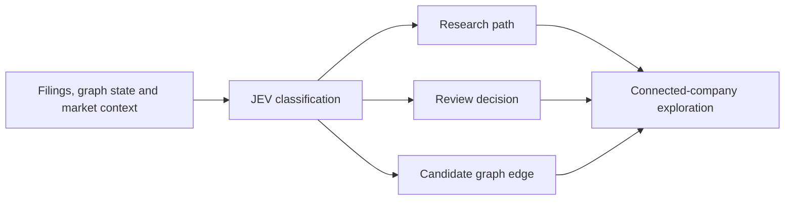

# Equity Space Graph

Equity Space Graph is an experiment in seeing the AI economy as a living system rather than a watchlist.

An NVIDIA node is interesting on its own. It becomes much more interesting when you can move outward into foundries, memory, networking, data centers, power, cooling, raw materials, customers, investors and financing relationships—and then ask what a new filing, price move or macro event could mean across that system.

That is the idea behind this project: a visual, queryable map of public and private companies connected by economic relationships and grounded, where possible, in primary evidence.


## Why classifiers are interesting here

Classifiers are not new. I used them as a machine-learning engineer years before the current generation of language models. What feels fresh is how cleanly a modern typed classifier can sit inside a product like this.

The graph regularly encounters small but consequential decisions:

- Is this question about dependency, risk, price action, comparison or current news?
- Does the available evidence support a supplier relationship, or does it only mention a competitor?
- Is a filing excerpt material enough to expand into another investigation?
- Is the system confident enough to publish an edge, or should someone review it?

JEV is used for those moments. It returns bounded choices, scores and probabilities that the rest of the application can inspect. The result is less about putting another chat box on a dataset and more about making the research process visible, testable and easier to reason about.

This is not a benchmark or a claim that JEV is the only way to build the decision layer. I have not yet compared this implementation with Laya or the wider range of open-source classifier options. That would be a worthwhile next experiment. The repository is intentionally open to that kind of play: swap the classifier, change the labels, build an evaluation set and see what actually works.

## What the experiment includes

- A zoomable map of the AI value chain and capital network.
- Public and private companies spanning chips, foundries, packaging, networking, cloud, power, cooling, construction and materials.
- Equity prices, market capitalization, company news and macro catalysts.
- First- and second-order propagation views.
- SEC filing discovery and attributable relationship extraction.
- A reviewable evidence backfill for named suppliers, customers, investors and counterparties.
- A graph-aware copilot that can use the companies and relationships currently in view.

## Where JEV appears

There are three small decision surfaces rather than one oversized prompt.

### Asking the graph

The copilot uses JEV to understand the shape of a question, whether current information is needed, how complete the supplied evidence looks and how significant the possible impact may be. Those signals help the application assemble the right slice of the graph and its supporting context.

### Beginning an investigation

Starting from a ticker, JEV helps prioritize the next useful research lane: customers, suppliers, ownership, capacity, capital expenditure or material risk. It can also signal that the evidence is thin or that a human should look at the result before it becomes part of the trusted graph.

### Reading filings

Candidate relationships are extracted from primary filings with exact excerpts and URLs. JEV then helps classify the relationship, assess how directly the excerpt supports it and estimate materiality. The interesting part is not merely extracting text; it is turning unstructured disclosure into a decision that can be inspected later.



The current implementation also uses Groq for fast extraction and synthesis, Finnhub for market data and news, SEC EDGAR for filings, and Cloudflare D1 for persistent evidence and quote snapshots. These are replaceable pieces, not philosophical commitments.

## A few important caveats

This is a personal project and an evolving research prototype, not investment advice or a complete model of the economy. A relationship in a graph can look more certain than it really is, so the interface keeps verified, inferred and reviewable connections distinct.

A shared industry does not automatically make two companies supplier and customer. A falling stock price does not, by itself, create an operational impact on another company. A named entity in a risk factor may be a competitor rather than a counterparty. Those distinctions are precisely why a classifier-and-evidence approach is useful here.

## Project shape

```text
src/                React entry point, page components and global styles
components/         Shared graph, intelligence and market-data UI
functions/api/      Cloudflare Pages Function entry points
server/             Copilot, research, market, news and backfill handlers
db/                 D1 access, schema and persistence functions
drizzle/            Versioned database migrations
lib/                Graph, market-symbol, macro-calendar and SEC utilities
public/             Curated graph, capital-flow and universe datasets
```

The browser application is React 19 with Vite. The server-side endpoints run as Cloudflare Pages Functions, with D1 for relational state and Drizzle for the schema.

## Run it locally

You will need Node.js 22.13 or newer.

```bash
git clone <your-repository-url>
cd equity-space-graph
npm ci
cp .env.example .dev.vars
```

Add any provider credentials to `.dev.vars`. That file is ignored by Git. The visual frontend can run by itself:

```bash
npm run dev
```

For the full Pages environment, including local Functions and D1:

```bash
npm run build
npm run db:migrate:local
npm run preview
```

Before committing a change:

```bash
npm run validate
```

That command checks TypeScript, linting, the Vite production build and the Pages Functions bundle.

## Deploy your own copy to Cloudflare Pages

The repository includes `wrangler.example.jsonc` as a neutral starting point.

```bash
npx wrangler login
npx wrangler d1 create your-equity-space
```

Copy the returned D1 identifier into your `wrangler.jsonc`, leave the binding name as `DB`, and apply the migrations:

```bash
npx wrangler d1 migrations apply your-equity-space --remote
npx wrangler pages project create your-equity-space --production-branch main
```

Provider credentials belong in encrypted Pages secrets, never in source files:

```bash
npx wrangler pages secret put TYPESAFE_API_KEY --project-name your-equity-space
npx wrangler pages secret put GROQ_API_KEY --project-name your-equity-space
npx wrangler pages secret put FINNHUB_API_KEY --project-name your-equity-space
npx wrangler pages secret put SEC_USER_AGENT --project-name your-equity-space
```

Then update the project name in the deployment script and publish:

```bash
npm run validate
npm run deploy
```

The included GitHub Actions workflow can deploy pushes to `main`. It expects `CLOUDFLARE_ACCOUNT_ID` and `CLOUDFLARE_API_TOKEN` in GitHub Actions secrets.

## Make it your own equity space

The AI universe is only the first use case. It could just as easily become a map of biotech, defense, energy, financial infrastructure, a regional economy or a personal portfolio.

The easiest place to begin is the data:

- `public/graph-data.json` contains the core layers, companies and operating relationships.
- `public/capital-flows.json` contains investments, financing and purchase commitments.
- `public/universe-expansion.json` widens the public and private company universe.

Then make the questions your own. The classifier definitions live in:

- `server/copilot.ts`
- `server/investigate.ts`
- `server/backfill.ts`

Try different classes. Replace JEV with another classifier. Compare a specialist model with an open-source alternative. Change what counts as sufficient evidence. Build a small labeled evaluation set instead of judging the output by feel. The useful part of this repository is that those experiments have a real product surface and a real graph behind them.

For a different domain, I would also revisit the source hierarchy. SEC filings work well for U.S. public companies, while another universe may depend on home-market regulators, government records, clinical trial registries, procurement databases or issuer disclosures.

## Runtime configuration

| Variable | Used for |
| --- | --- |
| `TYPESAFE_API_KEY` | JEV classification calls |
| `TYPESAFE_MODEL` | JEV model selection |
| `GROQ_API_KEY` | Fast extraction and synthesis |
| `GROQ_MODEL` | Groq model selection |
| `FINNHUB_API_KEY` | Quotes, company profiles, news and earnings |
| `SEC_USER_AGENT` | SEC-compliant application identity and contact |

Only the variable names belong in the repository. Values should live in `.dev.vars` locally and encrypted Pages secrets in production.

## Ideas worth exploring next

- Compare JEV with Laya and open-source classifier models on the same labeled questions.
- Measure calibration and false-verification rates, not only raw accuracy.
- Add home-market filings for non-U.S. issuers.
- Version relationships as contracts, ownership and capacity commitments change.
- Separate market propagation from operational propagation more rigorously.
- Let people publish and share their own thematic equity spaces.

## License

Released under the [MIT License](LICENSE). Feel free to fork it, reshape the universe, try another classifier or use the underlying ideas in a different domain.
